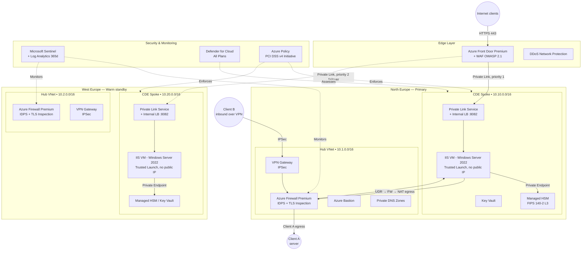
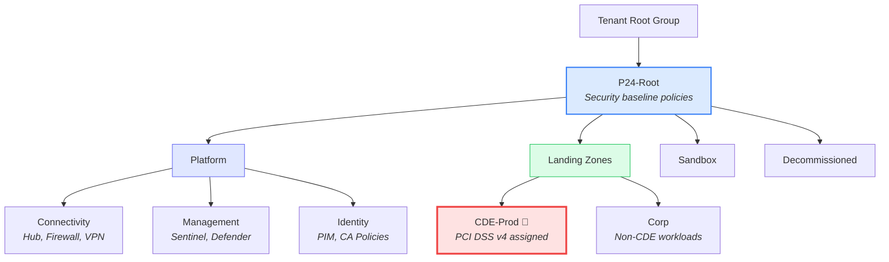
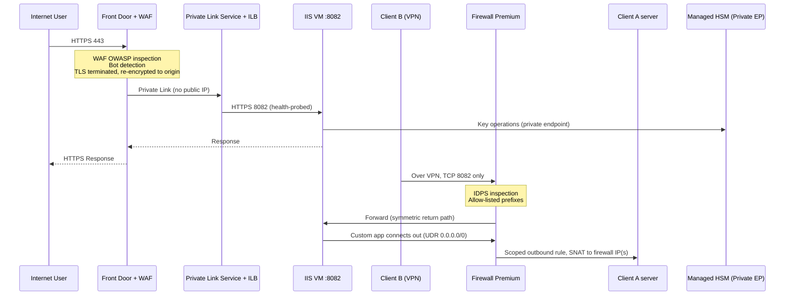
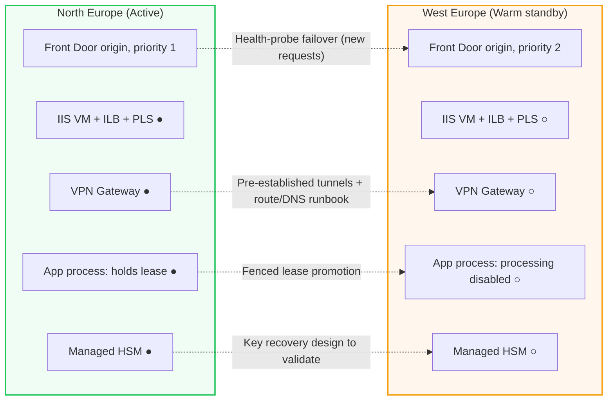

# Azure Landing Zone for PCI-DSS v4.0

Azure Landing Zone for a **PCI DSS v4.0 Cardholder Data Environment (CDE)** using hub-spoke topology with defence-in-depth controls. The workload runs on **Windows IIS VMs in North Europe and West Europe** (HTTPS on TCP 8082), published through Front Door Premium + WAF over Private Link, with VPN connectivity for partner clients.

> The repository is infrastructure as code. It has been validated statically (Terraform `validate` and tests, Bicep build) and has not been deployed to a customer subscription. Deploying it does not by itself establish PCI DSS compliance; validate scope and controls with your QSA.

### Interactive Visualizations

| Diagram | View |
|---------|------|
| **Architecture Diagram** (5 views: topology, traffic flow, management groups, security layers, DR) | [Open Embedded Diagram](https://microsoftmrinal.github.io/azure-landing-zone-pci-dss/#architecture) |
| **Landing Zone Explained Simply** (14 animated slides, kid-friendly) | [Open Embedded Explanation](https://microsoftmrinal.github.io/azure-landing-zone-pci-dss/#simple) |

## Architecture Overview



An optional data platform (Azure SQL with TDE + CMK and immutable audit storage) is available behind `deploy_data_platform` (default `false`) for deployments whose application needs it.

## Management Group Hierarchy



## Traffic Flow

Public web traffic reaches IIS through Front Door and Private Link. It does **not** traverse the firewall; WAF inspects it at the edge. VPN and egress traffic is inspected by the regional firewall.



## Security Layers (Defence-in-Depth)

```mermaid
graph LR
    A[Attacker] ==>|Blocked| L1

    subgraph L1["Layer 1: Edge"]
        FD2[Front Door WAF]
        DDOS2[DDoS Protection]
    end

    subgraph L2["Layer 2: Network"]
        FW3[Firewall IDPS]
        NSG[NSGs]
        PE[Private Endpoints / PLS]
    end

    subgraph L3["Layer 3: Identity"]
        MFA[Phishing-Resistant MFA]
        PIM[PIM Just-in-Time]
        CA[Conditional Access]
    end

    subgraph L4["Layer 4: Application"]
        MI[Managed Identity]
        TL[Trusted Launch IIS VM]
    end

    subgraph L5["Layer 5: Data"]
        CMK[CMK Disk Encryption]
        HSM2[Managed HSM]
        WORM[Immutable Storage]
    end

    L1 --> L2 --> L3 --> L4 --> L5

    style L1 fill:#fef2f2,stroke:#ef4444,stroke-width:2px
    style L2 fill:#fff7ed,stroke:#f59e0b,stroke-width:2px
    style L3 fill:#faf5ff,stroke:#a78bfa,stroke-width:2px
    style L4 fill:#f0fdf4,stroke:#22c55e,stroke-width:2px
    style L5 fill:#eff6ff,stroke:#3b82f6,stroke-width:2px
```



## Disaster Recovery

Each failure type has its own mechanism; RTO/RPO targets must be agreed with the business and measured in recovery drills. See [docs/architecture.md](docs/architecture.md) for the full failover design.



## Design Principles

| Principle | Implementation |
|-----------|---------------|
| Single public web entry | Front Door Premium + WAF; VMs have no public IPs. VPN gateways and firewall egress still use their own public IPs |
| No public IPs in CDE | Enforced by Azure Policy deny |
| Egress through Firewall | UDR 0.0.0.0/0 → Firewall on every spoke subnet |
| Private origins | Front Door → Private Link Service → internal load balancer → IIS on TCP 8082 |
| Private key plane | Managed HSM and Key Vault via private endpoints only |
| HSM-held keys | Managed HSM / Key Vault Premium with CMK for VM disks (and SQL TDE when enabled) |
| Least privilege | PIM just-in-time, phishing-resistant MFA, Entra sign-in to VMs, no standing owners |
| Regional recovery | Front Door priority failover; separate VPN, private DNS, state/key and worker-ownership mechanisms |
| Defence-in-depth | Five concentric security layers |

## Well-Architected Framework Alignment

- **Reliability**: Warm-standby second region, dependency-aware health probes, dual-region VPN, fenced worker promotion; targets defined and measured, not assumed
- **Security**: Zero-trust network, HSM key management, IDPS inspection, WAF, policy-driven governance
- **Cost Optimization**: Right-sized VM, firewall and VPN SKUs; standby capacity sized to recovery objectives
- **Operational Excellence**: IaC-only deployment, CI/CD with OIDC, Sentinel + Defender monitoring
- **Performance Efficiency**: Load-tested IIS on 8082, firewall SNAT and HSM latency baselines

## Repository Structure

```
├── modules/
│   ├── management-groups/     # ALZ management group hierarchy
│   ├── policy/                # PCI DSS v4 policy assignments
│   ├── connectivity/
│   │   ├── hub/               # Hub VNet, subnets, Bastion, VPN gateway
│   │   ├── spoke/             # CDE spoke VNet, NSGs, Private Link Service subnet
│   │   ├── firewall/          # Azure Firewall Premium, Client A/B rules
│   │   ├── front-door/        # Front Door Premium + WAF, private VM origins
│   │   └── dns/               # Private DNS zones
│   ├── security/
│   │   ├── defender/          # Microsoft Defender for Cloud
│   │   ├── sentinel/          # Microsoft Sentinel workspace
│   │   └── identity/          # PIM, Conditional Access
│   ├── data-platform/
│   │   ├── sql/               # Azure SQL with TDE + CMK (optional)
│   │   ├── storage/           # Immutable audit storage (optional)
│   │   └── hsm/               # Managed HSM, Key Vault, Disk Encryption Set
│   └── application-platform/
│       └── compute/           # Windows IIS VM + internal LB + Private Link Service
├── environments/
│   ├── prod/                   # North Europe primary
│   └── dr/                     # West Europe warm standby (hub, VPN, firewall, spoke, IIS VM)
├── bicep/                      # Bicep equivalent of the NEU + WEU deployment
├── .github/workflows/          # CI/CD pipeline
└── docs/                       # Architecture & compliance docs
```

## Prerequisites

- Terraform >= 1.5
- Azure CLI >= 2.50
- An Azure tenant with Global Administrator access (initial setup)
- GitHub Actions with Workload Identity Federation (OIDC)
- A certificate for the application FQDN (covering both regions) for IIS on TCP 8082

## Quick Start

```bash
# Clone the repository
git clone https://github.com/microsoftmrinal/azure-landing-zone-pci-dss.git
cd azure-landing-zone-pci-dss/environments/prod

# Initialize Terraform
terraform init

# Review the plan
terraform plan -var-file="terraform.tfvars"

# Apply (requires appropriate Azure permissions)
terraform apply -var-file="terraform.tfvars"
```

See [docs/deployment-guide.md](docs/deployment-guide.md) for the phased deployment order, West Europe stack, Front Door approvals and Client A/B configuration.

## PCI DSS v4.0 Compliance

This landing zone maps the 12 PCI DSS requirements to Azure-native controls. See [docs/pci-dss-mapping.md](docs/pci-dss-mapping.md) for the requirement-to-control mapping. The mapping is an input to a QSA assessment, not an attestation.

## Deployment Phases

| Phase | Scope |
|-------|-------|
| 0 | Foundation & Governance (MG, Policy, Defender, Identity) |
| 1 | Connectivity & Security (Hub-spoke, Firewall, VPN, Bastion) |
| 2 | Key Platform (HSM, Key Vault, Disk Encryption Set) and optional data platform |
| 3 | Application Platform (IIS VMs, internal LB + Private Link Service, Front Door) in both regions |
| 4 | Validation & Go-live (Compliance evidence, failover tests, QSA prep) |

## License

MIT License - See [LICENSE](LICENSE) for details.
