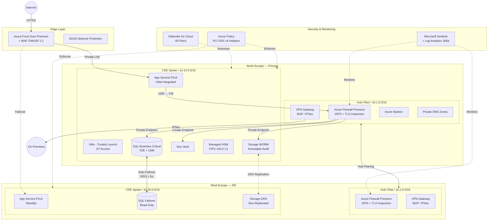
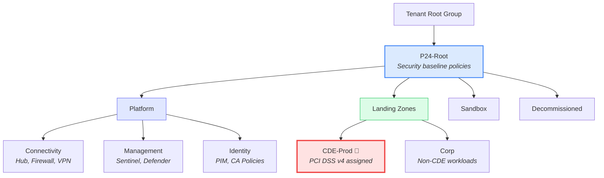
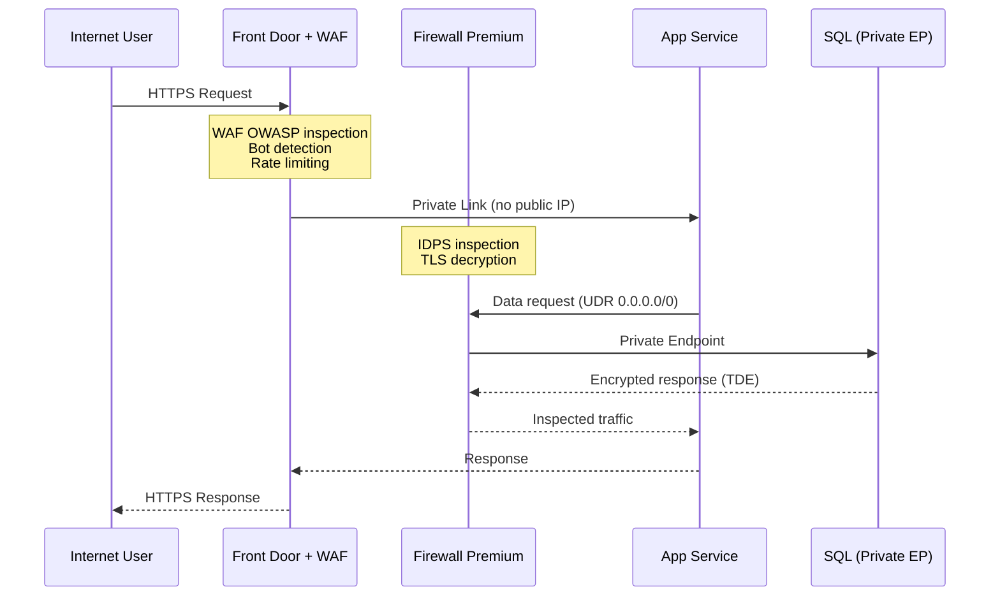
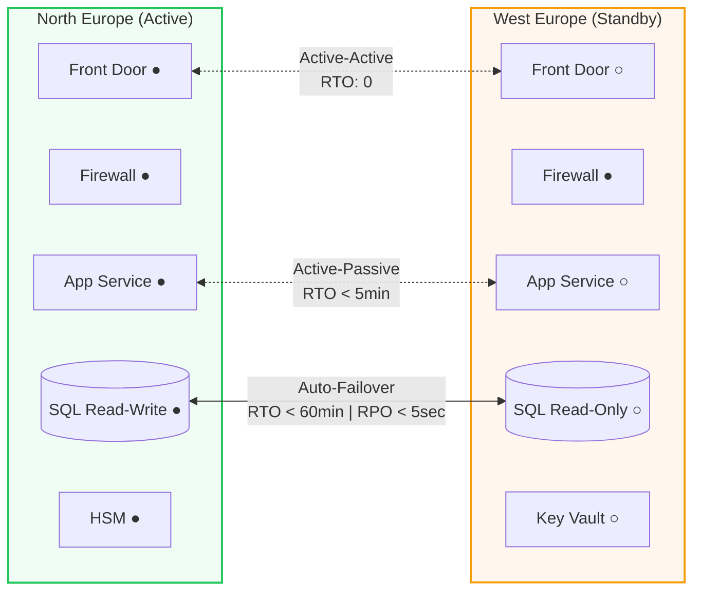

# Azure Landing Zone for PCI-DSS v4.0

Production-ready Azure Landing Zone implementing a **PCI DSS v4.0 compliant Cardholder Data Environment (CDE)** using hub-spoke topology with defence-in-depth controls.

## Architecture Overview



## Management Group Hierarchy



## Traffic Flow



## Security Layers (Defence-in-Depth)

```mermaid
graph LR
    A[Attacker] ==>|Blocked| L1

    subgraph L1["Layer 1: Edge"]
        FD2[Front Door WAF]
        DDOS2[DDoS Protection]
    end

    subgraph L2["Layer 2: Network"]
        FW3[Firewall IDPS]
        NSG[NSGs]
        PE[Private Endpoints]
    end

    subgraph L3["Layer 3: Identity"]
        MFA[Phishing-Resistant MFA]
        PIM[PIM Just-in-Time]
        CA[Conditional Access]
    end

    subgraph L4["Layer 4: Application"]
        MI[Managed Identity]
        VNET[VNet Integration]
    end

    subgraph L5["Layer 5: Data"]
        TDE[TDE + CMK]
        HSM2[Managed HSM]
        WORM[Immutable Storage]
    end

    L1 --> L2 --> L3 --> L4 --> L5

    style L1 fill:#fef2f2,stroke:#ef4444,stroke-width:2px
    style L2 fill:#fff7ed,stroke:#f59e0b,stroke-width:2px
    style L3 fill:#faf5ff,stroke:#a78bfa,stroke-width:2px
    style L4 fill:#f0fdf4,stroke:#22c55e,stroke-width:2px
    style L5 fill:#eff6ff,stroke:#3b82f6,stroke-width:2px
```



## Disaster Recovery



## Design Principles

| Principle | Implementation |
|-----------|---------------|
| Single public entry | Front Door Premium + WAF; no other internet-facing surface |
| No public IPs in CDE | Enforced by Azure Policy deny |
| All egress through Firewall | UDR 0.0.0.0/0 → Firewall on every spoke |
| Private data plane | SQL, Storage, Key Vault, HSM via private endpoints only |
| HSM-held keys | Payment HSM / Managed HSM with CMK for TDE |
| Least privilege | PIM just-in-time, phishing-resistant MFA, no standing owners |
| Active DR | Front Door + SQL auto-failover across NEU ↔ WEU |
| Defence-in-depth | Five concentric security layers |

## Well-Architected Framework Alignment

- **Reliability**: Multi-region active-passive DR, zone-redundant services, auto-failover groups
- **Security**: Zero-trust network, HSM key management, IDPS inspection, WAF, policy-driven compliance
- **Cost Optimization**: Right-sized SKUs, reserved capacity for predictable workloads
- **Operational Excellence**: IaC-only deployment, CI/CD with OIDC, Sentinel + Defender monitoring
- **Performance Efficiency**: Front Door caching, zone-redundant compute, Business Critical SQL tier

## Repository Structure

```
├── modules/
│   ├── management-groups/     # ALZ management group hierarchy
│   ├── policy/                # PCI DSS v4 policy assignments
│   ├── connectivity/
│   │   ├── hub/               # Hub VNet, subnets, peering
│   │   ├── spoke/             # CDE spoke VNet
│   │   ├── firewall/          # Azure Firewall Premium
│   │   ├── front-door/        # Front Door Premium + WAF
│   │   └── dns/               # Private DNS zones
│   ├── security/
│   │   ├── defender/          # Microsoft Defender for Cloud
│   │   ├── sentinel/          # Microsoft Sentinel workspace
│   │   └── identity/          # PIM, Conditional Access
│   ├── data-platform/
│   │   ├── sql/               # Azure SQL with TDE + CMK
│   │   ├── storage/           # Immutable audit storage
│   │   └── hsm/               # Managed HSM / Payment HSM
│   └── application-platform/
│       ├── app-service/        # VNet-integrated App Service
│       └── compute/            # Trusted Launch VMs + JIT
├── environments/
│   ├── prod/                   # North Europe primary
│   └── dr/                     # West Europe disaster recovery
├── .github/workflows/          # CI/CD pipeline
└── docs/                       # Architecture & compliance docs
```

## Prerequisites

- Terraform >= 1.5
- Azure CLI >= 2.50
- An Azure tenant with Global Administrator access (initial setup)
- GitHub Actions with Workload Identity Federation (OIDC)

## Quick Start

```bash
# Clone the repository
git clone https://github.com/microsoftmrinal/azure-landing-zone-pci-dss.git
cd azure-landing-zone-pci-dss/environments/prod

# Initialize Terraform
terraform init

# Review the plan
terraform plan -var-file="terraform.tfvars"

# Apply (requires appropriate Azure permissions)
terraform apply -var-file="terraform.tfvars"
```

## PCI DSS v4.0 Compliance

This landing zone addresses all 12 PCI DSS requirements through Azure-native controls. See [docs/pci-dss-mapping.md](docs/pci-dss-mapping.md) for the full requirement-to-control mapping.

## Deployment Phases

| Phase | Scope | Duration |
|-------|-------|----------|
| 0 | Foundation & Governance (MG, Policy, Defender, Identity) | 2 weeks |
| 1 | Connectivity & Security (Hub-spoke, Firewall, VPN, Bastion) | 2 weeks |
| 2 | Data & Key Platform (HSM, SQL, Storage, Private Endpoints) | 2 weeks |
| 3 | Application Platform (App Service, Front Door, VMs) | 2 weeks |
| 4 | Validation & Go-live (Compliance proof, DR test, QSA prep) | 2 weeks |

## License

MIT License - See [LICENSE](LICENSE) for details.
